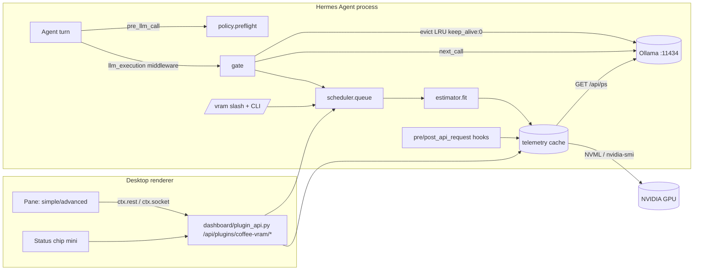

# Coffee — 本機模型 VRAM 守門員（Hermes Agent 外掛）設計／開發規格 v0.2

> 作者：JIMMY（JYUN MING CHEN）｜目標：Nous Research Hermes Agent Plugin Hackathon（截止 2026-11-12 06:00 台北時間 UTC+8）
> 交件：① catalog PR ② X 示範影片（<90s）③ Typeform
> 標記約定：**【未確認】** = 文件未明載或需在 Spark 上實測，每項都附 fallback。
> 文件來源（2026-11-05 讀取）：Hermes plugin developer guide、Desktop Plugin SDK、Catalog submission（admission rules 1–18）、Ollama `docs/api.md` + `docs/faq`、NVIDIA 推論最佳化技術部落格（KV 公式）。

---

## 0. v0.2 實作現況（2026-11-05）

v0.1 是動工前的規格。下列決定以原始碼研究和 Spark 實測為準（數據見 `RESEARCH.md`），
本文其餘章節已依此更新；§6 的偽代碼保留為原始草稿，實作以 `coffee/*.py` 為準。

| 主題 | v0.1 規格 | v0.2 實作 | 依據 |
|---|---|---|---|
| 擋下呼叫 | `pre_llm_call` block／middleware 短路 | **failopen**：middleware 只排隊、逐出、等待；逾時（`queue_timeout_s`）就放行並通知 | middleware 例外會被跳過；`pre_llm_call` block 會吞掉使用者訊息 |
| 門檻 | `block_pct`、`on_overflow: queue/ask/block/warn_only` | `hold_pct`、`on_overflow: queue/wait/warn_only` | 同上；`ask` 在無人值守時無意義 |
| hooks | 6 個 hook | 只用 `post_api_request`、`api_request_error`（host 隔離模式下用來釋放 ticket） | `pre_api_request` 帶整段對話，不需要 |
| 遙測 | `nvidia-ml-py` 依賴 | ctypes 直接呼叫 `nvml.dll`／`libnvidia-ml.so.1`，再退 nvidia-smi、null；**零 Python 依賴** | RESEARCH §1 |
| 容量 | NVML total | NVML total（carve-out 62.5 GiB）；CUDA 池 109.7 GiB 不用 | RESEARCH §1、§6 |
| `num_ctx` | 從請求讀 | `/v1` 忽略 `num_ctx`；context 取觀察值 → `OLLAMA_CONTEXT_LENGTH` → 模型上限 | RESEARCH §3 |
| KV 估算 | 全部層 | 只算完整注意力層（`full_attention_interval`、逐層 `head_count_kv`）；載入過的模型用實測大小 | RESEARCH §4 |
| 放不下的大模型 | block | 不算錯誤：GPU 需求上限 ＝ hold 線 − 桌面基線（15 分鐘外部用量最低值）− 釘選模型；只發一次 `partial` 提示 | RESEARCH §6 |
| 多模型 | LRU 逐出 | `OLLAMA_MAX_LOADED_MODELS=1` 時交給 Ollama 換模型，Coffee 只在外部程式佔用時等待；>1 時 LRU 逐出 | RESEARCH §5，使用者決定「both」 |
| 配色 | 自有 tokens `--cf-*` | 只用主題變數 `var(--ui-*)`；自有色票延到 v1.1 主題「Coffee Crema」 | SDK 規定、使用者決定 |
| 推播 | `ctx.socket('/events')` | 輪詢 `/snapshot` 2 s ＋ `/events?since=`；同行程時另有 `plugin.coffee-vram.event` 推播加速 | plugin host 子行程的 broadcast 會被丟棄 |
| 中斷 | — | 私有 import `tools.interrupt.is_interrupted`（try/except 包住），PR 說明並開 issue 要公開 seam | catalog rule 9 警告，使用者決定保留 |
| 與核心的關係 | 未提 | README／PR 明寫：核心 `local_runtime` 管 Hermes 自己的 llama-server；Coffee 管外部 Ollama 的多模型排隊、逐出、保溫 | RESEARCH §7 |

## 1. 名稱與一句話賣點

- **名稱：Coffee**。plugin id：`coffee-vram`（catalog 已查，無 `coffee`／`coffee-vram`／`coffre`／`vram` 同名）。
- 標語：*Managing local models, as easy as a cup of coffee.*
- 一句話（EN）：**Coffee keeps your local models from blowing up VRAM: it watches GPU memory live, checks whether a model fits before Hermes calls it, and queues, keeps warm, or evicts models so multi-model agent runs never OOM.**
- 中文：Agent 跑本機模型時，自動防爆 VRAM／RAM；多模型任務智慧排隊引流；容量夠就讓模型保溫不卸載，減少冷啟動。
- 品牌守則：不使用 Hermès 字樣、H 標誌、橘色盒子或馬車意象（Rule 15「vendor-lookalike skins」＋商標風險）。風格只「致敬氣質」：低調、工藝；主題名 **Coffee Crema**。

## 2. 問題與證據

| 證據 | 內容摘要 | Coffee 對應 |
|---|---|---|
| Issue #142082 | 本機模型多任務／子代理並行造成記憶體爆掉、卡死 | 呼叫前 fit check ＋ 佇列 |
| Issue #120495 | 本機模型冷啟動／模型切換等待過久 | keep-warm 策略 |
| Issue #92304 | 缺少 GPU／VRAM 可視化或資源狀態 | Desktop pane ＋ status chip |
| Issue #5904 | 本機 provider 資源管理／並行控制需求 | scheduler + policy |
| PR #149222 headroom | 部分重疊（context／token headroom），非 GPU 記憶體 | 互補，README 註明差異 |

> 【未確認】上表 issue 摘要依先前 prior-art 掃描的標題，PR 描述引用前請 JIMMY 逐一點開確認原文字句。
> 實際痛點（Spark）：主模型 `qwen3.8-flash-next-huihui:iq3s`（84GB 檔，~56GB VRAM，128K ctx）在 64GB Windows 可見 VRAM 下只剩 ~8GB；此時 agent 若叫 `nemotron-3.5-bolt`（24GB）或 ComfyUI 同時跑圖，必定溢出到系統 RAM 或 OOM。

## 3. 功能分期

### MVP（本週末，必做）
1. **Telemetry**：NVML（`nvidia-ml-py`）→ fallback `nvidia-smi`；Ollama `/api/ps`（`size`、`size_vram`、`expires_at`）。1s 取樣，環形緩衝 10 分鐘。
2. **Estimator**：模型權重（`/api/ps` 實測 > `/api/tags` 檔案大小 × 係數）＋ KV cache（公式 §6.2）＋ overhead。
3. **Policy**：`warn` / `ask` / `block` 三段；門檻 warn 85%、block 95%（可調）。
4. **Gate（llm_execution middleware）**：只攔 base_url 為本機 Ollama 的呼叫；fit → 放行；不 fit → 依序：等待 idle → 逐出 LRU 閒置模型（`keep_alive:0`）→ 仍不行則 block 並回訊息。
5. **Queue**：本機模型呼叫序列化（per-GPU 單一 slot，可調 `max_concurrent_local`），FIFO＋同模型優先合併（減少切換）。
6. **Keep-warm**：容量允許時不卸載；只在需要空間時逐出 LRU。
7. **Slash 指令**：`/vram`、`/vram queue`、`/vram settings`；CLI：`hermes coffee-vram status|queue|evict <model>`。
8. **Desktop**：右側/底部 pane（Simple 視圖）＋ status bar chip（迷你模式）＋ 越界 toast/OS 通知。
9. **config_schema**：簡易設定（5 項）會自動產生 Settings 表單。

### v1.1
- Advanced 視圖（時間序列圖、每模型拆解、佇列甘特、事件 log）。
- `MODEL_MENU_ROW_AREA` 徽章：模型選單每列顯示「fits / tight / won't fit」。
- `pre_tool_call` 對 terminal 啟動 ComfyUI / `ollama run` / `python train.py` 等重 GPU 指令做 approve 提醒（啟發式）。
- 外部行程佔用（ComfyUI）偵測：NVML per-process 記憶體。
- 自動 `num_ctx` 降級建議（例：128K → 64K 可省多少 GB）。

### Later
- AMD（ROCm SMI）、Apple（`powermetrics`/IOKit 統一記憶體）backend。
- 多 GPU 擺放策略、llama.cpp server / vLLM provider。
- 歷史學習：以實測 `size_vram` 校正估算係數。

## 4. 架構



### 4.1 模組

| 模組 | 檔案 | 責任 |
|---|---|---|
| gpu | `coffee/gpu.py` | `NvmlBackend`（ctypes）→ `NvidiaSmiBackend`（`CREATE_NO_WINDOW`，跳過 NPU 列）→ `NullBackend` |
| ollama | `coffee/ollama.py` | `/api/ps`、`/api/tags`、`/api/show`（快取）、`keep_alive`／卸載（`/api/generate`）、`same_endpoint` |
| snapshot | `coffee/snapshot.py` | `LoadedModel`（含 `spill`）、`Snapshot`（Ollama 用量、外部用量、外部基線） |
| estimator | `coffee/estimator.py` | `estimate(...) -> Estimate(weights, kv, overhead, total)`，混合注意力、實測校正 |
| policy | `coffee/policy.py` | `decide(...) -> Decision(GO/EVICT/WAIT/PASS, need, partial, evict=[...])`、`plan_eviction` |
| scheduler | `coffee/scheduler.py` | `threading.Condition` FIFO、slot 數、LRU 表 |
| monitor | `coffee/monitor.py` | 取樣執行緒、keep-warm、閒置卸載、事件環（200）、歷史（900 點）、`status()` |
| gate | `coffee/gate.py` | `llm_execution` middleware：排隊、逐出、等待、逾時放行；host 模式 raise-to-continue |
| hooks | `coffee/hooks.py` | 註冊 middleware 與兩個 hook |
| commands／report | `coffee/commands.py`、`coffee/report.py` | `/vram`、`hermes coffee-vram`、`vram_status` 工具與文字輸出 |
| api | `dashboard/plugin_api.py` | `GET /snapshot`、`/events?since=`、`/history`、`/estimate?model=`、`POST /evict`；經 `sys.modules["hermes_plugins.coffee_vram"].MONITOR` 共用 Monitor |
| desktop | `desktop/plugin.js` | status chip（點開即完整面板）、pane、命令面板指令、toast／OS 通知 |

### 4.2 Hermes 接點（實作）

```python
def register(ctx):
    MONITOR = Monitor(ctx.get_config)                       # 模組全域，給 dashboard/plugin_api.py 找
    ctx.register_middleware("llm_execution", make_gate(MONITOR))
    ctx.register_hook("post_api_request", on_api_done)      # 依 api_request_id 釋放 host 模式的 ticket
    ctx.register_hook("api_request_error", on_api_done)
    ctx.register_command("vram", vram, args_hint="[queue|models|settings|evict <model>]")
    ctx.register_cli_command("coffee-vram", help=..., setup_fn=setup_cli, handler_fn=...)
    ctx.register_tool("vram_status", "coffee-vram", VRAM_STATUS_SCHEMA, vram_status)
```

- middleware 收到的 kwargs 已確認含 `model`、`base_url`、`session_id`、`api_request_id`、`next_call`、`request`。
  只有 `base_url` 指向 `ollama_url`（loopback 名稱視為相同，預設埠 11434）的呼叫會被攔；雲端一律直通。
- in-process：等到輪到、空間夠，再呼叫 `next_call()` 一次，`finally` 釋放 ticket。
- plugin host 隔離：`next_call` 傳過來是不可呼叫的 `Opaque`。Coffee 照樣排隊與逐出，然後 raise `Released`，
  讓 Hermes 跳過這層繼續；ticket 由 post/error hook 依 `api_request_id` 釋放（30 分鐘保底過期）。
- 沒用 `pre_llm_call`（block 會把使用者訊息換掉）和 `pre_api_request`（帶整段對話）。
- `/vram` 沒有撞名。工具 handler `(args, **kw) -> str` 回 JSON。

### 4.3 Slash / CLI

| 指令 | 輸出 |
|---|---|
| `/vram` | `Coffee 0.1.0 · GPU 9.1/62.5 GB (15%) · qwen3.5:9b 6.1 GB · queue 0 · warn 85% · hold 95%` |
| `/vram queue` | `1. running qwen3.5:9b  ~11.1 GB  3s  session abc` |
| `/vram models` | 每個模型的 GPU 用量、在系統記憶體的部分、ctx、剩餘保溫時間或「pinned」 |
| `/vram settings` | 目前設定（唯讀；修改走 Desktop 設定頁或 `config.yaml`） |
| `/vram evict <model>` | 卸載；正在回答或沒載入的模型會拒絕 |
| `hermes coffee-vram status [--json]`、`hermes coffee-vram evict <model> [--yes]` | 同上；`evict` 沒加 `--yes` 會先問 |

`ctx.ask_choice` 沒用：卸載閒置模型可逆、代價只是下次冷啟動，拒絕「正在回答」的模型已足夠安全。

### 4.4 Desktop

- Status chip：`STATUSBAR_AREAS.right`，`◆ 78%`，超過 warn 變 `--ui-yellow`、超過 hold 變 `--ui-red`、讀不到時變淡。
  **點開就是完整面板（Popover）**，因為關掉唯一的 pane 會停用整個外掛，chip 也會消失。
- Pane：`placement:'right'`、`dock:{pane:'files', pos:'bottom'}`、300×420，內容與 chip 面板相同。
- 命令面板：「Coffee: show GPU memory」打開 chip 面板。
- 面板：用量條（外部用量＋每個模型一段，標出 warn／hold 線）、模型（GPU 用量、系統記憶體部分、剩餘時間、兩段式卸載鈕）、佇列。
  `mode: advanced` 另加最近 15 分鐘 SVG 曲線與最近 8 則事件。
- 資料：`ctx.setInterval` 每 2 s 拉 `/snapshot`；`last_event` 變了才拉 `/events?since=`；歷史每 15 s 拉一次。
  `ctx.onEvent('plugin.coffee-vram.event')` 只用來提早觸發輪詢（host 模式收不到推播）。
- 通知：`warn` 事件 → `host.notify` warning；`alert` 事件 → error toast ＋ `ctx.os.notify`（只在 app 不在前景時跳）。
  開啟時已存在的事件只進清單、不跳通知。
- 設定：只用 `config_schema` 自動產生的表單，沒有自訂設定頁。
- 只 import `@hermes/plugin-sdk`、`react`、`react/jsx-runtime`；注入的 `<style>` 在 `ctx.onDispose` 移除；validate 的「desktop surface」檢查通過。

### 4.5 config_schema（預設值）

| key | type | default | 簡易/進階 | 說明 |
|---|---|---|---|---|
| `mode` | str choices `simple/advanced` | `simple` | 簡易 | 介面顯示模式 |
| `warn_pct` | int | `85` | 簡易 | 警告門檻 % |
| `hold_pct` | int | `95` | 簡易 | 超過就排隊等待的門檻 % |
| `on_overflow` | str choices `queue/wait/warn_only` | `queue` | 簡易 | 不夠放時：排隊並逐出／只等待／只警告 |
| `keep_warm` | bool | `true` | 簡易 | 容量允許時保溫模型 |
| `ollama_url` | str | `http://127.0.0.1:11434` | 進階 | 本機 Ollama |
| `reserve_gb` | float | `2.0` | 進階 | 系統/桌面保留 |
| `max_concurrent_local` | int | `1` | 進階 | 同時執行本機呼叫數 |
| `queue_timeout_s` | int | `600` | 進階 | 排隊上限，逾時 block |
| `evict_idle_s` | int | `20` | 進階 | 閒置多久才可被逐出 |
| `pinned_models` | list | `[]` | 進階 | 永不逐出（例：主模型） |
| `kv_cache_type` | str choices `f16/q8_0/q4_0` | `f16` | 進階 | 對應 `OLLAMA_KV_CACHE_TYPE` |
| `estimate_overhead_pct` | int | `10` | 進階 | 估算安全係數 |
| `sample_interval_ms` | int | `1000` | 進階 | 取樣週期 |
| `watch_external` | bool | `true` | 進階 | 計入 ComfyUI 等外部行程 |
| `gpu_total_override_gb` | float | `0.0` | 進階 | 驅動回報錯誤時手動指定容量；0 ＝ 自動 |

設定由 `ctx.get_config` 讀取，Monitor 每 2 秒重讀一次，不需要廣播或重啟。

## 5. 資料夾與 plugin.yaml

```
hermes-vram-guard/              # repo（plugin id = coffee-vram）
├── plugin.yaml
├── __init__.py                 # register(ctx)
├── coffee/
│   ├── __init__.py             # PLUGIN_ID, VERSION
│   ├── settings.py  snapshot.py  gpu.py  ollama.py
│   ├── estimator.py  policy.py  scheduler.py
│   ├── monitor.py  gate.py  hooks.py
│   └── commands.py  report.py
├── dashboard/
│   ├── manifest.json           # tab hidden；只掛 API
│   ├── dist/index.js           # 網頁 dashboard 會載 entry，放一行佔位避免 404
│   └── plugin_api.py
├── desktop/plugin.js
├── tests/                      # pytest（fakes.py 模擬 GPU／Ollama）
│   └── e2e/                    # 用 Hermes 的 Python 跑真實 middleware 鏈與 dashboard（唯讀）
├── scripts/                    # Spark 量測工具（measure_spark、measure_load、winpdh）
├── assets/                     # 截圖與 demo.jpg（待補）
├── README.md  LICENSE(MIT)  DESIGN.md  RESEARCH.md
```

```yaml
manifest_version: 2
name: coffee-vram
version: "0.1.0"
description: "Managing local models, as easy as a cup of coffee."
author: JYUN MING CHEN
license: MIT
requires_hermes: ">=0.22.0"    # llm_execution middleware 與 config_schema 都在這版；Spark 上是 0.22.7
tags: [local-models, ollama, gpu, vram, desktop]
provides_tools: [vram_status]
provides_hooks: [post_api_request, api_request_error]
provides_middleware: [llm_execution]
config_schema:                 # 完整內容見 plugin.yaml；鍵與預設值同 §4.5（測試會比對）
```
- 沒有 `api_version`、沒有 `python_dependencies`（NVML 走 ctypes、HTTP 走標準庫）。
- `capabilities:` 是「權限 id 清單」（例如 `tools.override`），不是 `provides_*` 的 mapping；Coffee 不需要任何權限，所以不宣告。validate 比對的是頂層 `provides_*`。

## 6. 偽代碼

> v0.1 草稿，保留作為設計脈絡。與實作不同處見 §0：沒有 `pre_llm_call` preflight、沒有 block／ask、
> 等待用 `threading.Condition`（middleware 是同步呼叫）、NVML 每行程用量在 WDDM 下拿不到（外部用量改用
> NVML used − Ollama 用量）、KV 公式加上混合注意力。實作以 `coffee/*.py` 和 `tests/` 為準。

### 6.1 Telemetry（Windows 無黑窗）
```python
# winproc.py
import subprocess, sys
NO_WINDOW = subprocess.CREATE_NO_WINDOW if sys.platform == "win32" else 0
def run(cmd, timeout=3):
    return subprocess.run(cmd, capture_output=True, text=True, timeout=timeout,
                          creationflags=NO_WINDOW, shell=False)

# nvidia_smi.py
Q = ["nvidia-smi", "--query-gpu=index,name,memory.used,memory.total,utilization.gpu",
     "--format=csv,noheader,nounits"]
# NVML 優先：nvmlInit → nvmlDeviceGetMemoryInfo(h) → used/total（bytes）
#           nvmlDeviceGetComputeRunningProcesses(h) → 外部行程（ComfyUI）佔用
# 失敗 → nvidia-smi → 再失敗 → NullBackend（只用 Ollama /api/ps 的 size_vram 加總）
```
- **Spark 統一記憶體**：NVML total 可能回 128GB 或 64GB 或 "N/A"【未確認】。Fallback：設定 `gpu_total_override_gb`（進階隱藏欄位）＋ 啟動時自檢，若 `memory.total` 為 N/A，用 `/api/ps` 加總＋ override。
- Ollama spill：`spill = size - size_vram`（>0 代表部分在系統 RAM，UI 顯示「溢出 RAM x GB」）。

### 6.2 KV cache 公式
來源：NVIDIA Technical Blog《Mastering LLM Techniques: Inference Optimization》：*Size of KV cache per token = 2 × num_layers × (num_heads × dim_head) × precision_in_bytes*（GQA 時 num_heads 用 KV heads）。
https://developer.nvidia.com/blog/mastering-llm-techniques-inference-optimization/

```python
BYTES = {"f16": 2, "q8_0": 1.0625, "q4_0": 0.5625}   # q8/q4 含 block scale，近似值
def kv_bytes(mi, num_ctx, kv_type, parallel=1):
    arch = mi["general.architecture"]
    L   = mi[f"{arch}.block_count"]
    Hkv = mi.get(f"{arch}.attention.head_count_kv", mi[f"{arch}.attention.head_count"])
    Dh  = mi.get(f"{arch}.attention.key_length") or mi[f"{arch}.embedding_length"] // mi[f"{arch}.attention.head_count"]
    return 2 * L * Hkv * Dh * num_ctx * parallel * BYTES[kv_type]
```
- `model_info` 來自 `POST /api/show`（欄位如 `llama.block_count`、`llama.attention.head_count_kv`，見 Ollama api.md）。
- `parallel` = `OLLAMA_NUM_PARALLEL`（FAQ：所需 RAM 隨 `OLLAMA_NUM_PARALLEL * OLLAMA_CONTEXT_LENGTH` 放大）。
- 混合架構（Qwen-Next 的 linear attention／MoE）KV 只存在部分層 → 公式會高估【未確認】；fallback：若該模型曾載入過，以 `/api/ps` 實測 `size` 為準並快取（`plugin_db`）。

### 6.3 Fit check
```python
def fit(snapshot, est, s):
    if est.model in snapshot.loaded:            # 已載入 → 只看 ctx 是否變大
        need = max(0, est.total - snapshot.loaded[est.model].size)
    else:
        need = est.total * (1 + s.estimate_overhead_pct/100)
    free = snapshot.total - snapshot.used - s.reserve_gb*GB
    after_pct = (snapshot.used + need) / snapshot.total * 100
    if need <= free and after_pct < s.block_pct: return Fit.OK(warn=after_pct >= s.warn_pct)
    return Fit.NO(need=need, free=free)
```

### 6.4 逐出（keep-warm vs LRU）
```python
def plan_eviction(snapshot, need, s, now):
    cands = [m for m in snapshot.loaded.values()
             if m.name not in s.pinned_models
             and not scheduler.in_flight(m.name)
             and now - lru.last_used(m.name) >= s.evict_idle_s]
    cands.sort(key=lambda m: lru.last_used(m.name))        # 最久未用優先
    plan, freed = [], 0
    for m in cands:
        if freed >= need: break
        plan.append(m.name); freed += m.size_vram
    return plan if freed >= need else None

async def evict(name):   # Ollama 官方：空 prompt + keep_alive 0 → 卸載
    await http.post(f"{url}/api/generate", json={"model": name, "keep_alive": 0})
```
- keep_warm=true：永不主動卸載，只在 `plan_eviction` 需要時卸；keep_warm=false：任務結束後 `keep_alive:0`。
- 也可在放行時透過 `llm_request` 改寫 `keep_alive`【未確認：OpenAI-相容端點是否接受 keep_alive／num_ctx】→ fallback：不改寫，只用 `/api/generate` 側呼叫管理。

### 6.5 Queue / gate
```python
async def gate_llm_execution(payload, next_call, **kw):
    tgt = resolve_target(payload, kw)                # 6.2 fallback：session 對照表
    if not tgt.is_local: return await next_call(payload)
    est = estimator.estimate(tgt.model, tgt.num_ctx)
    ticket = scheduler.enqueue(tgt, est)             # FIFO；同模型的 ticket 往前合併
    deadline = now() + s.queue_timeout_s
    while True:
        await ticket.wait_turn()                     # slot 數 = max_concurrent_local
        snap = telemetry.snapshot()
        r = fit(snap, est, s)
        if r.ok: break
        plan = plan_eviction(snap, r.need, s, now())
        if plan and s.on_overflow in ("queue", "ask"):
            if s.on_overflow == "ask" and not unattended(kw) and not user_ok(plan): return blocked(...)
            for m in plan: await evict(m)
            await telemetry.wait_drop(r.need, 15)
            continue
        if s.on_overflow == "warn_only": notify(...); break
        if s.on_overflow == "block" or now() > deadline:
            scheduler.release(ticket); return blocked(f"Coffee: {tgt.model} needs {r.need:.1f} GB, {r.free:.1f} GB free")
        await sleep(2)                               # 等其他 slot 跑完
    try:    return await next_call(payload)          # 恰一次
    finally: lru.touch(tgt.model); scheduler.release(ticket)
```
- `blocked()` 的回傳格式（短路時 middleware 要回什麼物件）【未確認】→ fallback：不短路，改在 `pre_llm_call` 以 `{"action":"block","message"}` 擋（preflight 先算一次）。
- middleware 是 sync 還是 async【未確認】→ 兩種都寫：sync 版用 `threading.Condition`。
- 無人值守（cron / gateway）：`ask` 自動退化為 `queue`，絕不等人（Rule 12）。

## 7. UI 設計語彙與線框

> v0.1.0 只用主題變數：`--ui-text-*`、`--ui-stroke-*`、`--ui-bg-*`、`--ui-accent`（模型、曲線）、
> `--ui-yellow`（warn）、`--ui-red`（hold／alert），淺色、深色主題都直接跟著換。下表的自有色票與字體留給 v1.1
> 的 `THEMES_AREA` 主題「Coffee Crema」，由使用者自己選用，不在面板裡寫死。7.2–7.4 的線框是概念圖，實作見 §4.4。

### 7.1 Tokens（v1.1 主題用；自有，非任何品牌）
| token | 值 | 用途 |
|---|---|---|
| `--cf-ink` | `#1E2433` | 主文字／深色底（墨藍） |
| `--cf-ivory` | `#F5F0E6` | 淺色底（象牙） |
| `--cf-parchment` | `#E8DFCF` | 卡片／分隔 |
| `--cf-cognac` | `#8A5A3C` | 主強調（干邑皮革，**刻意偏棕、避開橘**） |
| `--cf-brass` | `#B8975A` | 細線、刻度、chip 邊框（黃銅） |
| `--cf-sage` | `#6F7F6A` | OK 狀態 |
| `--cf-amber` | `#C08A2E` | warn |
| `--cf-bordeaux` | `#7A2E35` | block / 溢出 |
- 字體：標題 `"Cormorant Garamond", "Noto Serif TC", Georgia, serif`（使用者端有就用，**不打包字型檔**）；數字 `"IBM Plex Mono", ui-monospace` 並 `font-variant-numeric: tabular-nums`；內文沿用 app 主題字體。
- 尺寸：數字大字 28/32px light；標籤 11px letter-spacing .12em 全大寫小型字。
- 間距：4px 基準，8/12/16/24/40；圓角 2px（像縫線皮件的直角感）；邊框 1px brass 30% 透明度；「縫線」：`border-style: dashed` 1px 在卡片內緣 3px。
- 動態：220ms `cubic-bezier(.2,.7,.2,1)`；數值變化 tween 400ms；無彈跳；尊重 `prefers-reduced-motion`。
- 優先使用 SDK `ui.*` 元件與主題變數，tokens 只作 accent（深/淺色主題皆可讀）。可選加一個 `THEMES_AREA` 主題「Coffee Crema」（v1.1）。

### 7.2 Simple
```
┌─ COFFRE ───────────────────────── ◆ ┐
│  VRAM                                │
│  49.8 / 64.0 GB        78 %          │
│  ▕██████████████████▒▒▒▒▏ warn 85    │
│  ─ ─ ─ ─ ─ ─ ─ ─ ─ ─ ─ ─ ─ ─ ─ ─   │
│  ● qwen3.8-flash   56.1 GB  warm  📌 │
│  ○ nemotron-3.5    queued · 0:12     │
│  RAM spill  0.0 GB   Queue 1         │
│  [ Simple | Advanced ]   ⚙           │
└──────────────────────────────────────┘
```
### 7.3 Advanced
```
┌─ COFFRE · ADVANCED ──────────────────────────────── ◆ ┐
│ GPU0 RTX (NVML)  used 49.8  total 64.0  util 63%       │
│ 10m ╭──────╮___/‾‾‾‾\____ ── warn 85 ── block 95       │
│ MODELS        size  vram  spill  last use  keep         │
│ qwen3.8-flash 56.1  56.1  0.0    00:04     pinned       │
│ qwen3.5:9b     7.2   7.2  0.0    03:10     LRU#1        │
│ EXTERNAL  ComfyUI python.exe 6.4 GB                     │
│ QUEUE  #1 sub-agent-2 nemotron-3.5 est 26.3 GB wait 12s │
│        plan: evict qwen3.5:9b → still short 4.1 → wait  │
│ ESTIMATE  weights 24.0 + KV(32K,f16) 1.9 + 10% = 28.5   │
│ EVENTS 14:02:11 evicted qwen3.5:9b (LRU, idle 190s)     │
└─────────────────────────────────────────────────────────┘
```
### 7.4 Mini（status chip）
```
◆ 78%  ▕████▒▏ ·Q1      ← sage/amber/bordeaux；點擊開 pane；hover 顯示模型清單
```

## 8. Admission rules 自檢＋揭露

| Rule | 做法 |
|---|---|
| 3 無自更新 | 無 updater、無遠端 plugin.js |
| 6 能力相符 | 頂層 `provides_tools: [vram_status]`、`provides_hooks` 2 個、`provides_middleware: [llm_execution]`；validate「declared tools/hooks/middleware — matches registrations」 |
| 7 掃描 | 只有 `subprocess.run([...], shell=False)` 固定的 nvidia-smi 查詢；validate「security scan — safe」 |
| 8 Desktop SDK | 只 import 允許模組；無 eval、無 DOM 查詢、無 prototype patch；validate「desktop surface — stays inside the plugin SDK surface」 |
| 9 公開介面 | 只用 hooks／middleware／register_*；**唯一例外** `tools.interrupt.is_interrupted`（guarded），PR 說明＋開 issue（§11） |
| 11 憑證 | 不讀 `.env`／`auth.json`；不需任何金鑰 |
| 12 核准 | 不自動核准、不等人；佇列有逾時，逾時就放行 |
| 13 揭露 | 見下 |
| 14 相容性 | `requires_hermes: ">=0.22.0"`，plugin.yaml 與 catalog 相同 |
| 15 無仿冒 | 自有名稱；介面只用主題變數 |
| 17 無二進位 | 純 .py/.js/.md；`.gitignore` 排除 `__pycache__`、`.venv`、`measurements/raw/` |

**Disclosure（README＋PR）**：
- Network: only the configured Ollama URL (default `http://127.0.0.1:11434`). No third-party services. No telemetry.
- Commands: reads GPU memory through NVML; falls back to read-only `nvidia-smi --query-gpu` (`CREATE_NO_WINDOW` on Windows).
- Side effects: may unload idle, unpinned Ollama models (`keep_alive: 0`) and extend `keep_alive` on loaded ones. May delay local LLM calls up to `queue_timeout_s`; never cancels them.
- Background: one in-process sampling thread (1 s default), started on the first local call or when the Desktop panel opens.
- Data: recent samples and events in memory only. No files written, no credentials read.
- Private import: `tools.interrupt.is_interrupted`, guarded.

## 9. 測試與驗證

- 單元（pytest，55 個）：設定與 manifest 預設值一致；估算器以 Spark 實測校準（qwen3.5:9b、主模型）；policy（常駐模型、單槽、partial 上限、外部基線、warn_only）；scheduler FIFO 與逾時；遙測（nvidia-smi 解析含 NPU 的 `[N/A]` 列、keep-warm、閒置卸載、事件）；gate（排隊、逐出、逾時放行、host 模式）；指令與工具；dashboard 路由共用 Monitor。
- 假 GPU／Ollama：`tests/fakes.py` 的 `Pool` 讓卸載真的釋放記憶體。
- 實機 E2E（`tests/e2e/`，Hermes 的 Python＋臨時 `HERMES_HOME`）：真實 `run_llm_execution_middleware` 鏈（本機 211 ms、雲端 1 ms 直通）；dashboard 路由唯讀（NVML 2.99/62.50 GiB）。
- 待做（需要啟用外掛與重啟 gateway）：主模型常駐時叫 nemotron，觀察 queue → evict → run；ComfyUI 同跑時的 hold 與逾時通知；Desktop 截圖。
- 驗證：
```powershell
.\.venv\Scripts\python.exe -m pytest -q
hermes plugins validate .
hermes plugins doctor . --ci
```
- Desktop 開發：把 checkout 連結到 `<HERMES_HOME>\plugins\coffee-vram`（`mklink /J` 不需開發者模式），`hermes plugins enable coffee-vram`，重啟 gateway，Desktop → Capabilities → Plugins → Rescan → 啟用 Coffee。連結的 package 存檔即熱重載 `desktop/plugin.js`；Python 端改動仍要重啟 gateway。

### Demo 腳本（≤ 85s）
| 秒 | 畫面 | 旁白／字幕 |
|---|---|---|
| 0–8 | Desktop 右側 Coffee pane，主模型 56GB warm | "Local models + agents = VRAM roulette." |
| 8–20 | 叫 agent 開兩個子代理，一個要 nemotron 24GB | "Coffee checks fit before every local call." |
| 20–40 | pane 顯示 queued → evict qwen3.5:9b (LRU) → nemotron 跑；chip 從 amber 回 sage | "Queue, evict the idle one, keep the main model warm." |
| 40–55 | 同時開 ComfyUI → block toast「needs 26 GB, 8 GB free」 | "No OOM, no frozen desktop." |
| 55–70 | 切 Advanced：時間序列、估算拆解 | "Simple or advanced, your thresholds." |
| 70–85 | `/vram` 在聊天回報；logo 字樣 Coffee | "Coffee — open source, in the Hermes catalog." |

## 10. 週末時程（UTC+8）與 Cursor 提示

| 時段 | 目標 |
|---|---|
| 週五 20:00–24:00 | 骨架、telemetry（NVML/smi/Ollama）、`/vram` 可用、validate 綠 |
| 週六 09:00–13:00 | estimator + policy + scheduler + middleware gate，單元測試 |
| 週六 14:00–20:00 | plugin_api + desktop pane simple + chip + 通知 |
| 週六 21:00–24:00 | Spark 實測、校正 Spark 統一記憶體與 Qwen-Next KV |
| 週日 09:00–14:00 | Advanced 視圖、settings、README、截圖 |
| 週日 14:00–18:00 | 錄影剪輯 <90s、推 repo、取 40 字元 SHA、catalog PR、X 貼文 |
| 週日 18:00–  | Typeform；緩衝到 11/12 06:00 |

**Prompt 1（骨架）**
```
Read DESIGN.md in this repo. Create a Hermes Agent plugin "coffee-vram" with the folder layout in section 5: plugin.yaml (manifest_version 2, config_schema exactly as listed), __init__.py with register(ctx), and coffee/telemetry with a GpuBackend interface plus NvmlBackend (nvidia-ml-py), NvidiaSmiBackend (subprocess with CREATE_NO_WINDOW on Windows, shell=False) and NullBackend, and an OllamaProbe for /api/ps, /api/tags, /api/show using httpx with 2s timeouts. Register the /vram command via ctx.register_command returning a one-line status string. All hook callbacks take **kwargs. No monkeypatching of Hermes. Add pytest tests for nvidia-smi CSV parsing including [N/A].
```
**Prompt 2（核心）**
```
Implement coffee/estimator.py (KV formula in DESIGN.md 6.2 using /api/show model_info keys, with measured-size cache via plugins.plugin_storage), policy.py (6.3), scheduler.py (6.4/6.5: FIFO queue, same-model coalescing, slots = max_concurrent_local, LRU table, timeouts) and hooks.py registering pre_llm_call preflight, pre/post_api_request telemetry, and an llm_execution middleware gate that calls next_call exactly once. First log payload keys at debug level so we can confirm the payload shape. Only gate calls whose provider is ollama or base_url matches ollama_url. Never wait for a human in unattended runs. Unit tests for fit, eviction and queue.
```
**Prompt 3（Desktop）**
```
Create dashboard/manifest.json and dashboard/plugin_api.py (FastAPI router: GET /snapshot, /history, /queue, POST /evict with confirm flag, websocket /events pushing 1 Hz snapshots). Create desktop/plugin.js as plain ESM with jsx/jsxs from react/jsx-runtime, importing only @hermes/plugin-sdk, react and react/jsx-runtime. Register a 'panes' entry (placement right, dock next to files), a STATUSBAR_AREAS.right chip, toasts via host.notify and ctx.os.notify. Use the design tokens in DESIGN.md 7.1 and wireframes 7.2–7.4, SVG sparkline, no DOM queries, no eval, no external libs. Fall back to ctx.rest polling every 2s if the socket drops.
```
**Prompt 4（收尾）**
```
Write README.md (English) with install, screenshots, configuration table and the disclosure block from DESIGN.md section 8. Run `hermes plugins validate . --install-deps` and `hermes plugins doctor . --ci`, fix every failure and list remaining warnings.
```

## 11. Catalog YAML 與 PR 描述（草稿，未送出）

```yaml
name: coffee-vram
repo: https://github.com/<github-user>/hermes-vram-guard
sha: <40-hex commit sha>
title: Coffee
description: Managing local models, as easy as a cup of coffee.
maintainer: <github-user>
tier: community
category: models           # desktop | memory | platform | web | tools | voice | automation | models | general
version: "0.1.0"
requires_hermes: ">=0.22.0"
image: https://raw.githubusercontent.com/<github-user>/hermes-vram-guard/<sha>/assets/demo.jpg   # 2:1
screenshots: []            # 待補：chip 面板、pane（simple／advanced）
platforms: []              # 沒有 NVIDIA 時只用 Ollama 回報的大小
capabilities:
  provides_tools: [vram_status]
  provides_hooks: [post_api_request, api_request_error]
  provides_middleware: [llm_execution]
  requires_env: []
```

**PR title:** `plugin-catalog: add coffee-vram (VRAM guard for local models)`

**PR body:**
```
## What it does
Coffee keeps Hermes' local Ollama calls inside GPU memory. Before each call whose base_url points at your Ollama, it estimates what the model needs (weights + KV cache for the context the server will really use) and checks it against what is loaded. If it fits, the call runs. If not, the call waits in a FIFO queue while Coffee unloads the least recently used idle model; with OLLAMA_MAX_LOADED_MODELS=1 it leaves the swap to Ollama and only waits out other programs (ComfyUI, games). Calls are never cancelled: after queue_timeout_s they run anyway with a notification. Loaded models are kept warm while there is room.

## How this differs from the built-in VRAM budget
Hermes core's `hermes_cli/local_runtime` budgets the llama-server that Hermes itself launches: one model, checked before the server starts. Coffee manages an external Ollama the user runs: several models, checked on every call, with a queue, LRU eviction and keep-warm. On unified-memory machines they also read different pools on purpose: core budgets the CUDA pool for the server it launches, while Ollama loads into the GPU carve-out NVML reports and runs the rest on the CPU, so Coffee budgets the carve-out (RTX Spark: 109.7 GiB vs 62.5 GiB; measurements in RESEARCH.md).

Related issues (verify before submitting): #142082, #120495, #92304, #5904.

## Hermes surfaces
- Middleware: llm_execution (local Ollama calls only; everything else passes straight through)
- Hooks: post_api_request, api_request_error (release a queue slot when the plugin runs in the plugin host)
- Tool: vram_status · Command: /vram (queue, models, settings, evict) · CLI: hermes coffee-vram status|evict
- Desktop: status-bar chip whose popover is the full panel, one pane, a palette command; settings via config_schema; backend at /api/plugins/coffee-vram

## Private import (catalog rule 9)
`coffee/gate.py` imports `tools.interrupt.is_interrupted`, inside try/except, so a call waiting in Coffee's queue stops waiting when the user interrupts the turn. No public seam exposes the turn's interrupt state to middleware today; issue <link> asks for one. If the import fails, waiting ignores interrupts and everything else works.

## Disclosure
- Network: only the configured Ollama URL (default http://127.0.0.1:11434). No third-party calls, no telemetry.
- Commands: NVML through ctypes; read-only `nvidia-smi --query-gpu` as a fallback (no console window on Windows).
- Side effects: may unload idle, unpinned Ollama models (keep_alive: 0) and extend keep_alive on loaded ones; may delay local LLM calls up to queue_timeout_s, never cancels them.
- Background: one in-process sampling thread (1 s default).
- No files written, no credentials read, no Python dependencies.

## Validation
`hermes plugins validate .` passes at the pinned SHA; the only warning is the private import above. `hermes plugins doctor . --ci` passes. 55 unit tests; E2E through the real llm_execution chain on an RTX Spark.
```

**Issue 草稿（送 PR 前開，連結填進上面的 `<link>`）**

```
Title: Expose the turn's interrupt state to llm_execution middleware

A middleware that waits before calling next_call (a queue in front of a local model server)
should stop waiting when the user interrupts the turn. Today the only way to know is
`tools.interrupt.is_interrupted()`, which is private (catalog rule 9) and thread-scoped, so it
also does not work when the plugin runs in the plugin host.

Ask: pass an `is_interrupted` callable (or an Event) in the llm_execution middleware kwargs,
alongside session_id and api_request_id. Consumer: Coffee (VRAM guard for local Ollama models),
which currently imports tools.interrupt behind try/except.
```

## 12. X 貼文草稿（未發佈）

**主貼（≈250 字元）**
```
Running local models with Hermes Agent and keep hitting VRAM walls? Meet Coffee — managing local models, as easy as a cup of coffee. Live GPU memory, fit checks before every Ollama call, smart queueing, keep-warm + LRU eviction. No more OOM. #HermesAgent @NousResearch [video]
```
**Thread（選用）**
1. `How it works: weights + KV cache (layers × KV heads × head dim × ctx) vs free VRAM → run, queue, evict the idle model, or block with a clear reason.`
2. `Simple view, advanced view, or just a status-bar chip. Your thresholds. Pinned models never unload. Open source, in the Hermes plugin catalog: <link>`

中文說明：主貼打痛點＋三個核心（即時、防爆、排程保溫），影片放主貼；thread 1 用公式顯示技術含量給評審；thread 2 放 catalog/repo 連結。字數約 250，發佈前用 X 計數再確認（emoji/連結算法）。

## 13. 風險與【未確認】清單

| # | 項目 | 狀態 |
|---|---|---|
| 1 | `llm_execution` payload 欄位、sync/async、短路 | ✅ 有 `model`／`base_url`／`session_id`／`api_request_id`；同步；例外會被跳過 → failopen（§0、§4.2） |
| 2 | `/v1` 能否傳 `num_ctx`／`keep_alive` | ✅ `keep_alive` 可、且會沿用；`num_ctx` 被忽略（RESEARCH §2–3） |
| 3 | Spark NVML 數值 | ✅ total 62.5 GiB（carve-out），used 即時；每行程 N/A（RESEARCH §1） |
| 4 | 混合注意力 KV 高估 | ✅ 只算完整注意力層＋實測校正（RESEARCH §4） |
| 5 | `/vram` 撞名 | ✅ 沒撞（doctor 通過） |
| 6 | `requires_hermes`、`api_version` | ✅ `>=0.22.0`；沒有 `api_version` 欄位 |
| 7 | `capabilities` 格式、catalog `category` | ✅ plugin.yaml 用頂層 `provides_*`；catalog 用 `capabilities:` 區塊、`category: models` |
| 8 | `nvidia-ml-py`／httpx 依賴 | ✅ 都不用（ctypes、urllib） |
| 9 | pane `dock.pos`、`registerSettingsPage` | ✅ `pos` 為 top/bottom/left/right/center，用 `bottom`；不需自訂設定頁 |
| 10 | Issue #142082/#120495/#92304/#5904 內容 | ⏳ PR 前逐一點開確認 |
| 11 | 載入中／外部程式同時要記憶體的 race | 部分：每次決策前重新取樣；外部高於 15 分鐘基線時等待，逾時放行 |
| 12 | 逐出外部（非 Hermes）正在用的模型 | 部分：只逐出 Ollama `expires_at` 沒在前進、且 Hermes 閒置 ≥ `evict_idle_s` 的模型；pinned 保護 |
| 13 | Windows symlink 權限 | ✅ 用 `mklink /J`（junction），Desktop 也認得是 linked package |
| 14 | 私有 import `tools.interrupt` | ⏳ PR 說明＋開 issue（§11） |
| 15 | Desktop 實機畫面與 demo 流程 | ⏳ 需要啟用外掛並重啟 gateway |

公司檔案與私有路徑不得出現在公開 repo（`.gitignore` 掉 `*.log`、`data/`、`measurements/raw/`）。
