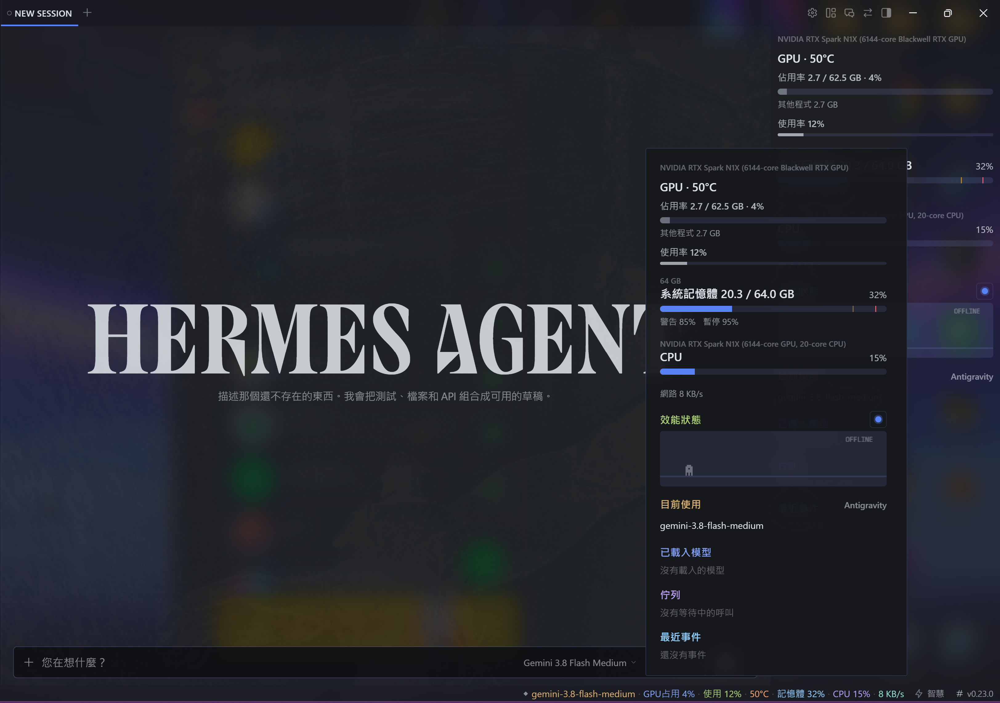
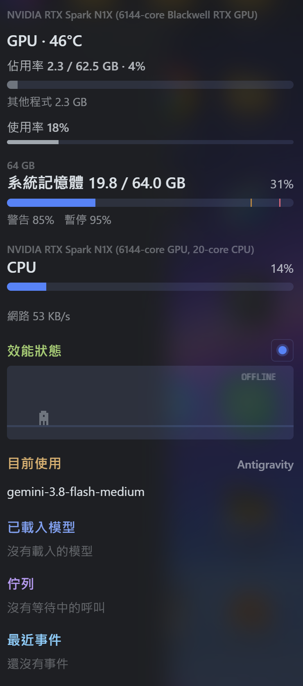

# Coffee — Managing local models, as easy as a cup of coffee.

Coffee keeps Hermes Agent's local Ollama calls from running the GPU out of memory. Before each
local call it checks whether the model fits next to what is already loaded. If it does not, the
call waits its turn while Coffee unloads an idle model to make room. Models stay warm while there
is space, so switching back has no cold start. You see all of it in a Desktop status-bar chip, a
pane, and `/vram`.

Cloud providers are never touched: only calls whose `base_url` points at your Ollama are gated.

## How Coffee differs from Hermes' built-in VRAM budget

Hermes core already has a hardware budget (`hermes_cli/local_runtime`). It serves a different
job:

| | Hermes core (`local_runtime`) | Coffee |
|---|---|---|
| Manages | The llama-server that **Hermes itself** launches | An **external Ollama** you run yourself |
| Question it answers | "Will this one model fit before I start the server?" | "Can this call run now, next to the models already loaded?" |
| Models | One | Several, with a queue, LRU eviction and keep-warm |
| When it acts | When the local runtime starts | On every local LLM call (an `llm_execution` middleware) |

On a unified-memory machine the two also measure different pools. On an RTX Spark (128 GiB) core
budgets against the CUDA pool (about 110 GiB), which is right for the server it launches. Ollama
loads into the GPU carve-out that NVML reports (62.5 GiB on that machine) and runs whatever does
not fit on the CPU, so Coffee budgets against the carve-out. Measurements are in
[RESEARCH.md](RESEARCH.md).

## What it does

- **Fit check before each local call.** The estimate is weights plus KV cache for the context the
  server will actually use, plus a safety margin. Hybrid-attention models (Qwen 3.5/Next) only
  count their full-attention layers; a model Coffee has seen loaded uses its measured size.
- **Queue.** Local calls run one at a time by default (`max_concurrent_local`), first come first
  served, so sub-agents do not load three models at once.
- **Make room.**
  - With `OLLAMA_MAX_LOADED_MODELS=1` Ollama swaps models itself, so Coffee only holds the call
    while other programs (ComfyUI, a game) are using the room.
  - With more than one model allowed, Coffee unloads the least recently used idle model.
    Pinned models and models answering a call are never unloaded.
- **Never blocks for good.** When the queue timeout passes (600 s by default), the call runs
  anyway and you get a notification. A model larger than the GPU is not an error: Ollama puts the
  rest on the CPU, and Coffee tells you once.
- **Keep-warm.** While memory is below the warn line, Coffee extends loaded models' `keep_alive`
  shortly before they expire. With keep-warm off, it unloads models idle longer than
  `evict_idle_s`.

## Where you see it

- **Desktop:** a status-bar chip that starts with `◆` and, depending on settings and available
  data, can show the active Hermes model name, GPU memory (`GPU 78%`), GPU compute utilization,
  GPU temperature, system RAM, CPU, network throughput, context usage, and tokens/second. The
  mark turns yellow past the warn line and red past the hold line (chip colour follows GPU memory
  occupancy). Click the chip for the panel; the same panel is also a pane next to Files, and the
  command palette has "Coffee: show GPU memory". Warnings show as toasts; alerts also send an OS
  notification while Hermes is in the background.

  The panel has:

  - **Gauges.** GPU memory with the warn and hold lines (when `alert_source` is `gpu`), a compute
    utilization bar, and optional GPU temperature. System RAM used/total (`show_system_ram`), CPU
    percent (`show_cpu`), and network throughput (`show_network`). Network is Windows-only: the
    backend meter uses PDH and is unavailable on other platforms. Each of these can be turned off
    in settings; they are on by default.
  - **Performance pet.** A small runner under a Performance heading. Its colour (white at idle
    through blue, amber, and pink/red) and run speed follow GPU compute utilization
    (`host.gpu_util_pct` from NVML / nvidia-smi, not memory occupancy). Decorative weather —
    clear, rain, snow, thunder, or fog — cycles on its own and does not follow utilization. The
    pet is live when the backend is up and at least one Ollama model is loaded; otherwise it
    shows as offline. A toggle next to the heading hides or shows the canvas. That choice is
    stored in Desktop `localStorage` under `coffee-vram.pet` (on by default).
  - **In use** (`show_active_model`, on by default). The model Hermes is currently using, cloud
    or local, with a provider label from the backend (`snap.active.provider`, recorded by
    `note_active()`). Context usage and tokens/second appear here and on the chip when
    `show_model_stats` is on, from the current conversation usage and, for a matching loaded
    model, the last local call.
  - **Loaded models**, including how much of a model runs from system RAM, an unload button, and
    the queue. Advanced view (`mode: advanced`) adds recent events. (The backend still keeps
    15-minute samples and serves `GET /history`, but the Desktop panel no longer draws that
    sparkline.)

- **In a session:** `/vram`, `/vram queue`, `/vram models`, `/vram settings`, `/vram evict <model>`.
- **Terminal:** `hermes coffee-vram status [--json]`, `hermes coffee-vram evict <model> [--yes]`.
- **The agent:** a `vram_status` tool, so a model can check free GPU memory before switching to
  another local model.

Closing Coffee's only pane disables the plugin, which is how Hermes treats panes. Re-enable it in
**Capabilities → Plugins**; **Reset layout** brings the pane back.

## Screenshots

Hermes Desktop with the Coffee chip in the status bar and the panel open:



The panel: GPU, system RAM, CPU and network, the Performance pet, the model in use, loaded models, queue and recent events:



## Install

```bash
hermes plugins install jimmy77733/coffee-vram
hermes plugins enable coffee-vram
```

Then restart the Hermes gateway so it mounts Coffee's middleware and backend routes. In Hermes
Desktop, open **Capabilities → Plugins**, press **Rescan**, and enable **Coffee** (the Desktop half
is off by default).

Requirements: Hermes Agent 0.22.0 or newer, Ollama on this machine, an NVIDIA GPU for live memory
readings. Without NVIDIA, Coffee falls back to the sizes Ollama reports.

## Settings

Settings live under `plugins.entries.coffee-vram.settings` in `config.yaml`, and Hermes Desktop shows
them as a form in **Settings → Plugins → Coffee**. Changes apply within two seconds; no restart.

| Key | Default | Meaning |
|---|---|---|
| `mode` | `simple` | `advanced` adds recent events to the panel |
| `alert_source` | `gpu` | Pool that fires warn/hold toasts and draws those marks on the matching gauge (`gpu` or `system_ram`). The status chip colour still follows GPU memory |
| `budget_pool` | `gpu` | Pool the call queue budgets against: `gpu`, `system_ram`, or `combined` (GPU free + system RAM free, not the sum of totals) |
| `warn_pct` | `85` | Notify when a call would push GPU memory past this share |
| `hold_pct` | `95` | Calls that would go past this share wait in the queue |
| `on_overflow` | `queue` | `queue`: wait and unload idle models. `wait`: wait without unloading. `warn_only`: notify and run |
| `keep_warm` | `true` | Extend `keep_alive` while there is room |
| `ollama_url` | `http://127.0.0.1:11434` | Your Ollama |
| `reserve_gb` | `2.0` | Memory left for the desktop |
| `max_concurrent_local` | `1` | Local calls that may run at once |
| `queue_timeout_s` | `600` | After this long a held call runs anyway |
| `evict_idle_s` | `20` | Idle time before a model may be unloaded |
| `pinned_models` | `[]` | Models Coffee never unloads |
| `kv_cache_type` | `f16` | Match `OLLAMA_KV_CACHE_TYPE` |
| `estimate_overhead_pct` | `10` | Safety margin on estimates |
| `sample_interval_ms` | `1000` | How often GPU memory is read |
| `watch_external` | `true` | Count other programs' GPU memory |
| `gpu_total_override_gb` | `0.0` | Set if the driver misreports the GPU pool; 0 detects it |
| `show_system_ram` | `true` | Show system RAM on the chip and panel |
| `show_cpu` | `true` | Show CPU on the chip and panel |
| `show_network` | `true` | Show network throughput (Windows only) |
| `show_gpu_temp` | `true` | Show GPU temperature on the chip and GPU block |
| `show_model_stats` | `true` | Show context usage and tokens/second on the chip and panel |
| `show_active_model` | `true` | Show the active Hermes model (cloud or local) on the chip and in an In use section |

## Disclosure

- **Network:** only the Ollama URL you configure (default `http://127.0.0.1:11434`). No third-party
  services, no telemetry.
- **Commands:** reads GPU memory through the NVIDIA driver library (NVML). If that is missing it
  runs `nvidia-smi --query-gpu=...` read-only, without a console window on Windows.
- **Side effects:** may unload idle, unpinned Ollama models (`keep_alive: 0`) and extend
  `keep_alive` on loaded ones. May delay local LLM calls up to `queue_timeout_s`; it never cancels
  them.
- **Background:** one sampling thread in the Hermes process (every second by default).
- **Data:** keeps recent samples and events in memory. To share the active Hermes route with the
  Desktop or dashboard process, the agent middleware writes `coffee-vram-active.json` in the
  Hermes home directory (from `get_hermes_home()`, or the `HERMES_HOME` environment variable, or
  `%LOCALAPPDATA%\hermes` if that folder exists, or `~/.hermes`). The file holds the current
  model, provider, and related route fields, and is ignored if older than 24 hours. Reads no
  credentials. The Desktop pet visibility preference is stored in the browser's `localStorage`
  under `coffee-vram.pet`, not as a file.
- **Private Hermes import:** `coffee/gate.py` imports `tools.interrupt.is_interrupted` so a queued
  call stops waiting when you interrupt the turn. The import is guarded; if a Hermes release moves
  it, waiting simply ignores interrupts until the call's turn comes.

## Development

```powershell
python -m venv .venv
.\.venv\Scripts\python.exe -m pip install pytest pyyaml fastapi httpx
.\.venv\Scripts\python.exe -m pytest -q
hermes plugins validate .
hermes plugins doctor . --ci
```

`tests/e2e/` holds two scripts that run against the live GPU and Ollama with Hermes' own Python
and a throwaway `HERMES_HOME`: the real `llm_execution` chain with a stub provider, and the
dashboard routes (read-only). Neither loads or unloads a model.

## License

MIT
